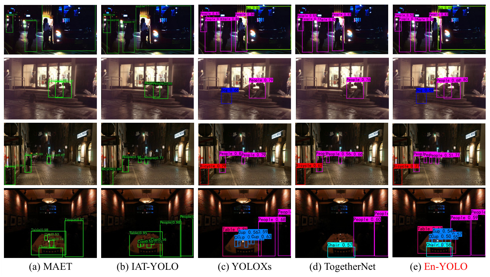
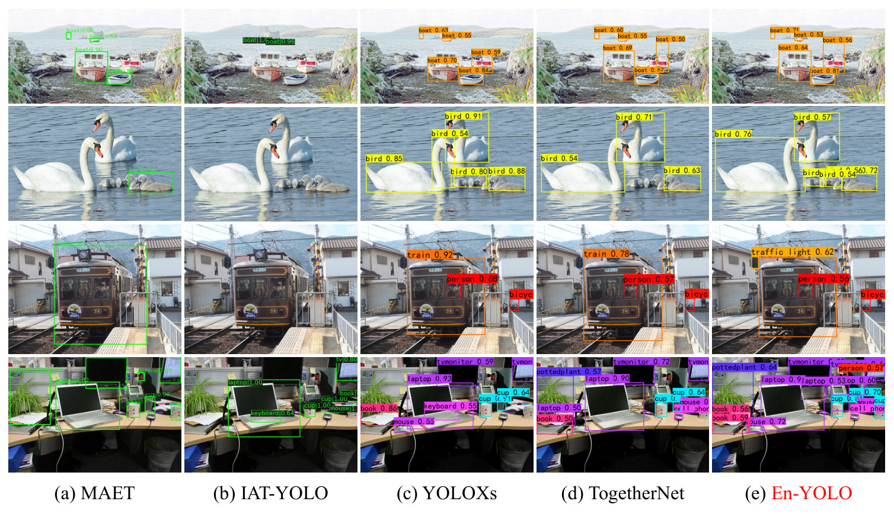

# En-YOLO

**Enhancing Low-Light Object Detection with En-YOLO: Leveraging Dual Attention and Implicit Feature Learning**

Xu Liu, Chenhua Liu, Xianye Zhou, and Guodong Fan · *Multimedia Systems*, 2025 · [Paper](https://doi.org/10.1007/s00530-025-01820-7)

## Overview

En-YOLO is an end-to-end object detector that jointly learns image enhancement and object detection. The detector uses features learned by the ENet restoration branch, and the Dual Attention-guided Feature Filtering (DAFF) module emphasizes features relevant to detection. The paper evaluates the method under low illumination on ExDark and under normal illumination on MS-COCO.

## Qualitative results

### Low-light detection on ExDark



*Figure 7 of the paper compares MAET, IAT-YOLO, YOLOXs, TogetherNet, and En-YOLO from left to right.*

### Normal-light detection on MS-COCO



*Figure 9 of the paper shows the same five detectors on MS-COCO test-dev 2017.*

## Trained weights

Download the [ExDark checkpoints from Google Drive](https://drive.google.com/drive/folders/16MiWcmp6N7jeat9QigMufzoQO5GB6pqd) and place the `.pth` files in `logs/`. Inference defaults to `logs/ep200-loss0.353-val_loss2.601.pth`. To use the epoch 195 checkpoint, update `model_path` in [`yolo.py`](yolo.py).

## Usage

Run the scripts from the repository root.

- **Inference.** Set the input and output paths in [`predict.py`](predict.py), then run `python predict.py`. For bounding-box labels, supply a TrueType font at `model_data/simhei.ttf` or change the font path in [`yolo.py`](yolo.py).
- **Training.** Configure the original and enhanced image annotation lists in [`train.py`](train.py), place the YOLOX-S initialization weights at `model_data/yolox_s.pth`, and run `python train.py`.
- **ExDark evaluation.** Set `VOCdevkit_path` in [`exdark_get_map.py`](exdark_get_map.py) to the VOC-format ExDark dataset root, then run `python exdark_get_map.py`.

The [`model_data/`](model_data/) directory includes class lists for ExDark, VOC, and COCO.

## Citation

```bibtex
@article{liu2025enyolo,
  title   = {Enhancing low-light object detection with {En-YOLO}: leveraging dual attention and implicit feature learning},
  author  = {Liu, Xu and Liu, Chenhua and Zhou, Xianye and Fan, Guodong},
  journal = {Multimedia Systems},
  year    = {2025},
  volume  = {31},
  pages   = {249},
  doi     = {10.1007/s00530-025-01820-7}
}
```

## License

See [LICENSE-YOLOX](LICENSE-YOLOX) for the upstream YOLOX license.
